# I build weird, small, fast projects.

## Current Project

**[DigDice](https://github.com/con-dog/dwarves-and-dice)**: a Steam first-person dice game inspired by Minecraft and Wolfenstein3D. You mine dice, build hands, and roll them to score points. Every world is generated from a seed, and every texel is generated from a seed, so the game ships with 0 asset files.

<table>
<tr>
<td width="50%">
  
</td>
<td width="50%">
  
</td>
</tr>
<tr>
<td width="50%">
  
</td>
<td width="50%">
  
</td>
</tr>
</table>

## Small Showcase

### [clingon](https://github.com/con-dog/clingon) · 432 commands in 20 packs, run by you or an AI

  

### [Minimio](https://github.com/con-dog/tiny-neural-network) · 18-byte neural network, solves 99% of unseen mazes

  

### [Snibble](https://github.com/con-dog/snibble) · 2048 agents at 60 FPS, 1-byte events, 100-byte replays

  

### [Slices](https://github.com/con-dog/slices-demo) · Space Invaders in 21 slices, one file each

  

## Stats

> [!WARNING]
> All benchmarks performed on a 2021 MacBook Pro with 16GB RAM
>
> Some benchmarks and claims change as I revisit projects and may become out of date

<table>
  <tr>
    <th colspan="3" align="left">Compression</th>
  </tr>
  <tr>
    <th align="left">Metric</th>
    <th align="left">Description</th>
    <th align="left">Project</th>
  </tr>
  <tr>
    <td>0 files</td>
    <td>Texture and map assets shipped with DigDice - every texel and every world is generated from a seed</td>
    <td>dig-dice</td>
  </tr>
  <tr>
    <td>1 bit</td>
    <td>A wall in the raycaster's chunked world map (a vertical stack of 16 walls fits in 2 bytes)</td>
    <td>chunked-z-level-raycaster</td>
  </tr>
  <tr>
    <td>1 byte</td>
    <td>Snibble's custom event protocol size</td>
    <td>snibble / snibble-bench</td>
  </tr>
  <tr>
    <td>5 keys</td>
    <td>DigDice's entire control mapping scheme (←↑→↓␣) handling 10+ actions and movement</td>
    <td>dig-dice</td>
  </tr>
  <tr>
    <td>18 bytes</td>
    <td>Maze-solving Neural Network solving 99% of unseen mazes</td>
    <td>maze-solver</td>
  </tr>
  <tr>
    <td>20MB</td>
    <td>Total size for a 100×100×10 chunk ray-casted world with O(1) lookup performance</td>
    <td>chunked-z-level-raycaster</td>
  </tr>
  <tr>
    <td>44 bytes</td>
    <td>Tether's entire memory: a maze walker with no map and no coordinates, on any grid under 67 million cells</td>
    <td>tether</td>
  </tr>
  <tr>
    <td>100 bytes</td>
    <td>Typical Snibble replay size for a 5 minute game (entire state)</td>
    <td>snibble / snibble-bench</td>
  </tr>
  <tr>
    <td>369 bytes</td>
    <td>Microlex's entire syntax-highlighting engine; each language adds a 37-178 byte state machine</td>
    <td>microlex</td>
  </tr>

  <tr>
    <th colspan="3" align="left">Performance</th>
  </tr>
  <tr>
    <th align="left">Metric</th>
    <th align="left">Description</th>
    <th align="left">Project</th>
  </tr>
  <tr>
    <td>2ms</td>
    <td>Snibble's average total frame time with 256 simultaneous players (logic AND rendering)</td>
    <td>snibble</td>
  </tr>
  <tr>
    <td>30x</td>
    <td>Speed of Microlex JavaScript lexical classifier vs PrismJS under equivalent benchmark (99.6% per-character agreement)</td>
    <td>microlex</td>
  </tr>
  <tr>
    <td>2048</td>
    <td>Simultaneous agents performing complex spatial/lexical/adversarial tasks at 60FPS</td>
    <td>snibble / snibble-bench</td>
  </tr>

  <tr>
    <th colspan="3" align="left">Accuracy</th>
  </tr>
  <tr>
    <th align="left">Metric</th>
    <th align="left">Description</th>
    <th align="left">Project</th>
  </tr>
  <tr>
    <td>89.9%</td>
    <td>Unseen mazes (up to 161×161, plus 1,600+ step game-map routes) Tether solves within 10× the shortest route, from four wall bits and one goal-direction bit - ahead of every Bug algorithm tested, all of which are told their position</td>
    <td>tether</td>
  </tr>
  <tr>
    <td>97.3%</td>
    <td>Blink link navigation prediction accuracy with a 10 byte Neural Network (best hand-written heuristic: 66.2%)</td>
    <td>blink</td>
  </tr>
  <tr>
    <td>100%</td>
    <td>Exact replay accuracy for Snibble replays</td>
    <td>snibble / snibble-bench</td>
  </tr>
</table>
