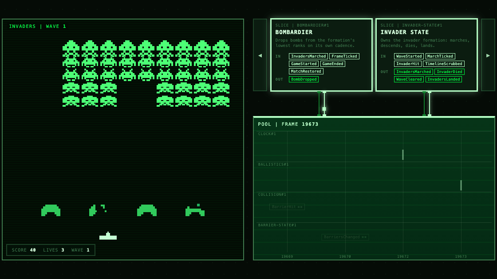

# Building Small, Fast, Weird Projects

## Current Project

**[DigDice](https://github.com/con-dog/dwarves-and-dice)**: a Steam first-person dice game inspired by Minecraft and Wolfenstein3D. You mine dice, build hands, and roll them to score points. Every world is generated from a seed, and every texel is generated from a seed, so the game ships with 0 asset files.

<table>
<tr>
<td width="50%">
  
</td>
<td width="50%">
  
</td>
</tr>
<tr>
<td width="50%">
  
</td>
<td width="50%">
  
</td>
</tr>
</table>

## Small Showcase

### [clingon](https://github.com/con-dog/clingon) - 432 commands - 20 packs - run by you or an AI

  

### [Minimio](https://github.com/con-dog/tiny-neural-network) - 18-byte neural network - solving 99% of unseen mazes

  

### [Snibble](https://github.com/con-dog/snibble) - 2048 agents - 60 FPS, 1-byte events - 100-byte replays

  

### [Slices](https://github.com/con-dog/slices-demo) - Space Invaders

  

